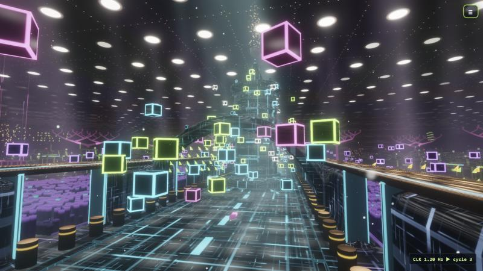
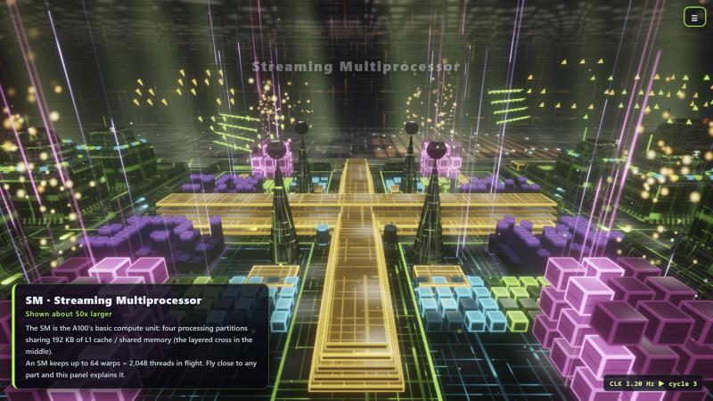
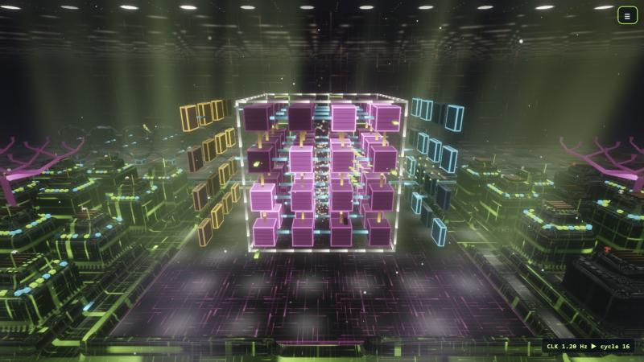
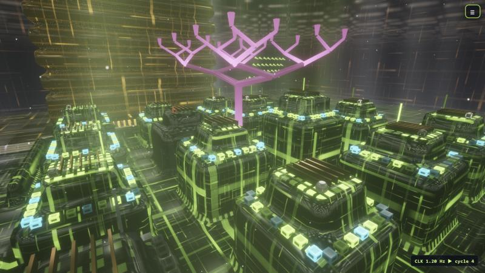
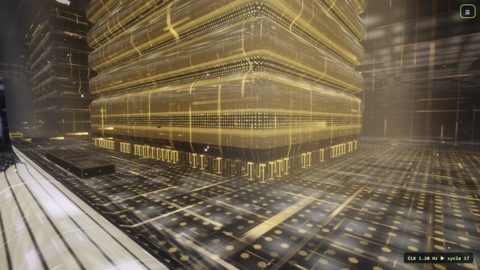
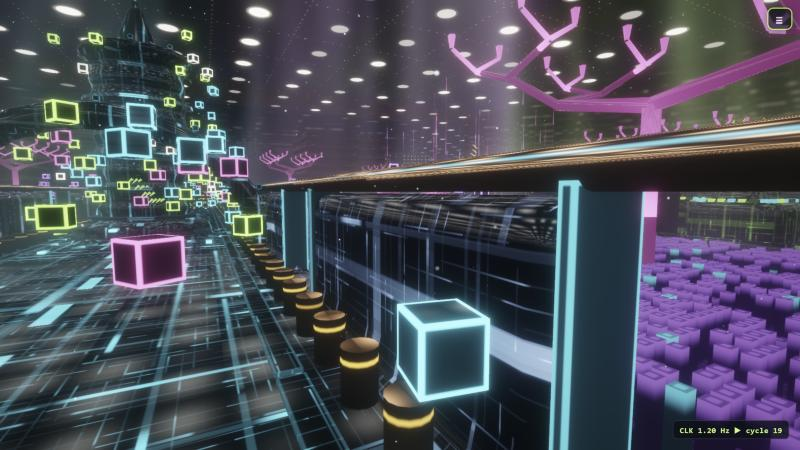
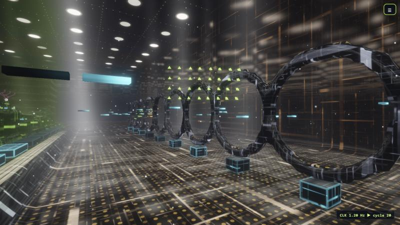

# ⚡ A100 Odyssey: Fly Inside an NVIDIA A100 GPU

<p align="center">
  
</p>

<p align="center">
  <a href="#-try-it-live"></a>
  <a href="#-zero-dependencies--single-file"></a>
  <a href="#-how-it-is-built"></a>
  <a href="#-license"></a>
  <a href="#-controls"></a>
</p>

---

## 🧭 Overview

**A100 Odyssey** is an explorable, real-time 3D simulation of the **NVIDIA A100 Tensor Core GPU (Ampere GA100)** running directly in your browser with **WebGPU**.

Fly through a glowing silicon metropolis where abstract hardware specs become visible, living structures:
- **Streaming Multiprocessors (SMs)** towering across 8 Graphics Processing Clusters (GPCs)
- **Tensor Cores** multiplying matrices along systolic wavefront diagonals
- **40 MB L2 Cache** materialized as a forest of tens of thousands of dynamic SRAM bit pillars
- **HBM2e Memory Stacks** connected via micron-scale micro-bumps on a silicon interposer
- **12 NVLink 3.0 Rings** streaming high-speed interconnect packets
- **SIMT Warps** flying in 32-thread formations that visibly split and serialize upon branch divergence

> **Researched and built by Hanz**: Translating the NVIDIA Ampere GA100 Architecture Whitepaper into an intuitive, interactive spatial world where anyone can see and understand how modern AI supercomputing hardware works.

---

## 🚀 Try It Live

You don't need to install anything, clone heavy dependencies, or configure build chains.

1. **Download [`index.html`](index.html)** (a self-contained **80 KB** file that runs completely offline).
2. **Open in Chrome, Edge, or any modern WebGPU-enabled browser** on a desktop computer.
3. Click **"Enter the chip"** and start flying through the silicon!

*(Note: Requires desktop WebGPU support. Firefox and Safari are rolling out experimental WebGPU flags).*

---

## 🏛️ Silicon World Gallery

Every region of the world accurately mirrors the architecture and dataflow of the NVIDIA A100:

| Feature & Viewpoint | Architectural Significance |
| :--- | :--- |
| <br/>**Enlarged Streaming Multiprocessor (~50×)** | **The Compute Engine of AI**<br/>Detailed breakdown of an SM into 4 processing partitions: warp scheduler spires, 256 KB register file pillars, INT32 / FP32 / FP64 execution units, Tensor Core arrays, and a unified 192 KB L1 data cache / shared memory hub. |
| <br/>**Tensor Core Systolic Array** | **312 TFLOPS Dense FP16 Throughput**<br/>A 4×4×4 multiply-accumulate (MAC) matrix lattice. Watch the systolic compute wavefront propagate along the diagonal as matrix multiplication occurs cycle-by-cycle. |
| <br/>**SM Towers & GPC Districts** | **108 Enabled Streaming Multiprocessors**<br/>8 GPC districts of glowing towers. Towers with red beacons represent the 20 SMs disabled for manufacturing yield (108 active out of 128 physical GA100 SMs). |
| <br/>**HBM2e Stack & Silicon Interposer** | **~1.6 – 2.0 TB/s Memory Bandwidth**<br/>8 stacked DRAM dies connected by through-silicon vias (TSVs) and micro-bumps onto a TSMC CoWoS (Chip-on-Wafer-on-Substrate) interposer. The 6th stack remains dark (fused off on A100). |
| <br/>**L2 Cache Forest** | **40 MB High-Speed Shared Cache**<br/>Divided into two symmetrical partitions flanking the crossbar canyon. Tens of thousands of SRAM bit pillars pulse as read/write waves sweep through lines. |
| <br/>**NVLink 3.0 Interconnect Rings** | **600 GB/s Multi-GPU Fabric**<br/>12 bidirectional interconnect rings where high-speed data packet pulses race between neighbouring GPUs in supercomputer clusters. |

---

## 🎮 Interactive Controls & Clock Mechanics

A simulated **chip clock** drives all pipeline stages, memory transactions, and warp flights. You can manipulate time to inspect pipeline phenomena:

| Category | Input | Action |
| :--- | :--- | :--- |
| **Movement** | <kbd>W</kbd> <kbd>A</kbd> <kbd>S</kbd> <kbd>D</kbd> | Fly forward, strafe left, back, right |
| | <kbd>Q</kbd> / <kbd>E</kbd> | Descend / Ascend |
| | <kbd>Shift</kbd> | High-speed flight boost |
| **Camera & Look** | `Mouse Movement` | Look around (click canvas to lock pointer) |
| **Teleport** | <kbd>1</kbd> – <kbd>6</kbd> | Quick jump to POIs: Crossbar, SM, Tensor Core, L2, HBM2e, NVLink |
| **Clock Control** | <kbd>Space</kbd> | **Freeze / Resume Clock**: halts cores, warps, and packets mid-cycle |
| | <kbd>N</kbd> | **Step 1 Clock Cycle**: advance the systolic wavefront by exactly 1 beat |
| | <kbd>[</kbd> / <kbd>]</kbd> | Decrease / increase simulation clock frequency |
| **SIMT Architecture** | <kbd>G</kbd> | **Toggle Branch Divergence**: forces 32-thread warps to split into serialized active/inactive groups (orange/green) and reconverge |
| **Interface** | <kbd>I</kbd> | Toggle live architectural inspection overlay |
| | <kbd>Esc</kbd> | Open system menu / release pointer lock |
| | <kbd>M</kbd> | Mute / unmute procedural Web Audio soundscape |
| | <kbd>H</kbd> | Toggle FPS, frame time & GPU execution timestamps |

> **📱 Mobile / Touchscreen:** Hold one finger to fly forward and drag to steer. Touch with a second finger to engage boost. Tap `≡` for the menu.

---

## 🔬 Architectural Mapping: Spec vs. Simulation

| Architecture Component | In the Simulation | Real NVIDIA A100 (Ampere GA100) Specs |
| :--- | :--- | :--- |
| **Process & Die Size** | Boundary walls representing package heat spreader | TSMC 7 nm FinFET · 826 mm² die · 54.2 Billion transistors |
| **Graphics Processing Clusters** | 8 distinct city districts | 8 GPCs (Graphics Processing Clusters) |
| **Streaming Multiprocessors** | 108 glowing towers; 20 dark towers with red yield markers | 108 active SMs (out of 128 on physical GA100 die) |
| **CUDA Cores** | Sub-divided core banks inside the magnified SM | 6,912 FP32 cores · 3,456 FP64 cores · 6,912 INT32 cores |
| **Tensor Cores** | 4×4×4 Multiply-Accumulate 3D systolic lattice | 432 Tensor Cores (3rd-gen) · 312 TFLOPS FP16 (dense) / 624 TFLOPS (sparse) |
| **Memory Subsystem** | 5 active 8-die HBM2e stacks on micro-bump floor; 1 disabled | 5 active HBM2e stacks · 5,120-bit bus · 40 GB / 80 GB · ~1.6 – 2.0 TB/s |
| **L2 Cache** | Two symmetric forests of 10,000+ dynamic bit pillars | 40 MB split L2 cache (6.7× larger than Volta V100) |
| **Interconnect** | 12 glowing photon rings with traveling data packets | NVLink 3.0 (12 links, 600 GB/s bidirectional) + PCIe 4.0 ×16 (64 GB/s) |
| **SIMT Execution** | Flocks of 32 coordinated arrows flying along H-tree conduits | 32 threads per warp · Simultaneous execution with independent program counters |

---

## 🛠️ How It Is Built

A100 Odyssey is built with zero third-party 3D engines (no Three.js, Babylon.js, or Unity) and zero image/mesh assets:

```
a100/
├── src/
│   ├── main.js        # Renderer loop, camera dynamics, clock engine, POI telemetry
│   ├── world.js       # Procedural chip layout, SM partitions, HBM stacks, NVLink rings
│   ├── shaders.js     # Custom WGSL shaders (PBR lighting, SDF raymarch, volumetric fog)
│   ├── audio.js       # Real-time procedural Web Audio synthesis (H-tree hum, clock clicks)
│   ├── math.js        # Matrix transforms, fast noise, surface net meshing utilities
│   └── quality.js     # Adaptive dynamic resolution & level-of-detail management
├── screenshots/       # Visual documentation
├── build.mjs          # Inlines & minifies sources into a standalone index.html
├── template.html      # Shell UI, loading bar, and control overlay
└── index.html         # Output self-contained single-file distribution (~80 KB)
```

- **Pure WebGPU & WGSL:** Direct low-level GPU programming using compute and vertex shaders.
- **Procedural Signed Distance Fields (SDF):** Compute shaders generate the silicon die, SM monoliths, crossbar canyons, and memory stacks; Surface Nets convert them to meshes on startup.
- **Instanced Geometry:** Tens of thousands of SRAM cells, CUDA cores, capacitors, and micro-bumps are rendered with hardware instancing and view-frustum grid culling.
- **Zero-Allocation GPU Animation:** Data packet pulses, systolic wavefronts, and warp trajectories are evaluated directly in vertex shaders from the clock uniform.
- **Dynamic Resolution & Adaptive LoD:** Continuously balances workload to ensure smooth 60+ FPS on everything from integrated GPUs to desktop rigs.
- **Synthesized Web Audio:** Audio is generated live with Web Audio API nodes: an H-tree power hum, air displacement whoosh scaled to flight speed, and acoustic ticks synchronized with clock edges.

### Rebuilding from Source

Prerequisites: [Node.js](https://nodejs.org/) v18+

```bash
# Minified production build (outputs index.html ~80 KB)
node build.mjs

# Readable unminified build (outputs index.readable.html for debugging)
node build.mjs --readable
```

---

## ❓ Frequently Asked Questions

<details>
<summary><b>Is this an exact scale reproduction of the A100 floorplan?</b></summary>
It is an architecturally accurate pedagogical model. The ratios, counts (108 active SMs, 5 HBM2e stacks, 40 MB L2, 12 NVLinks), and functional relationships are real, but the physical layout is arranged vertically and spatially to make flying through and inspecting components intuitive.
</details>

<details>
<summary><b>Why does it say "This scene needs WebGPU"?</b></summary>
A100 Odyssey relies on modern WebGPU APIs. Please ensure you are running Google Chrome or Microsoft Edge on desktop with hardware acceleration enabled.
</details>

<details>
<summary><b>Can I use this for academic lectures, tutorials, or presentations?</b></summary>
Yes! A100 Odyssey is open-source under the MIT License. It was created specifically to help students, researchers, and engineers grasp computer architecture concepts spatially.
</details>

---

## 📜 Credits & License

- **Research, Concept & Architecture Implementation:** [Hanz](https://github.com/wonghanz)
- **Rendering Foundation & Techniques:** Adapted and evolved from [Abyssal Garden](https://github.com/Noniv/abyssal-garden) by Maksymilian Dendura ([@Noniv](https://github.com/Noniv)), used under the [MIT License](LICENSE).
- **Architecture References:** *NVIDIA A100 Tensor Core GPU Architecture Whitepaper* (NVIDIA Corporation).

Distributed under the **MIT License**. See [`LICENSE`](LICENSE) for full details.
